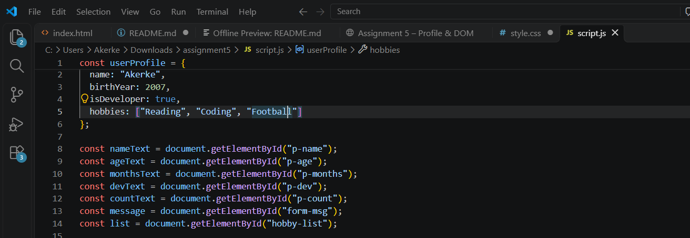
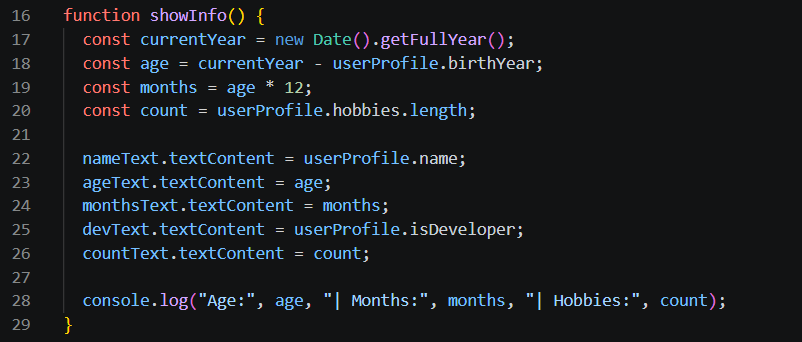
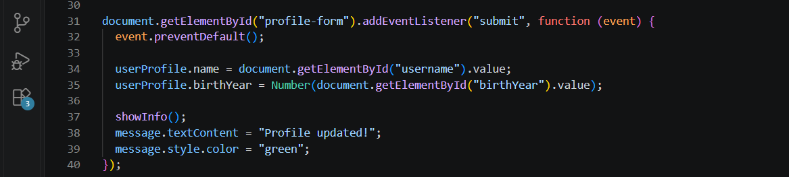
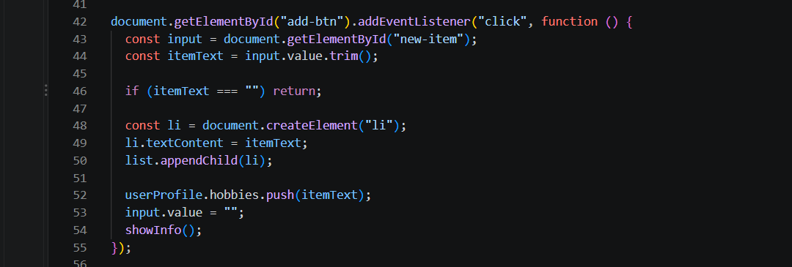
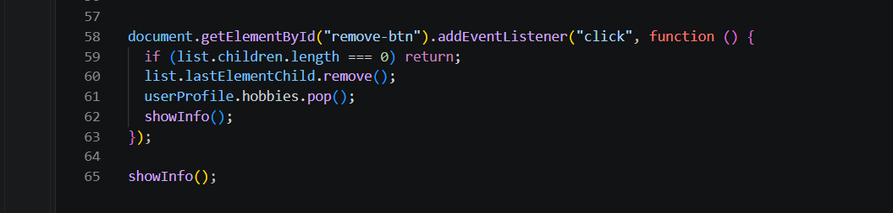

# Assignment #5 – JavaScript Basics

## Name and Group
Name: Akerke
Group: IT-2503

## Part 1: Profile Object, Data Types & Arithmetic

### Task 1: Personal Info Object
o	Create a JavaScript const object named userProfile that stores various data types: 
•	string (name), 
•	number (birthYear), 
•	boolean (isDeveloper), 
•	an array (hobbies).

### Task 2: Arithmetic Calculations
o	Write a script that uses arithmetic operators to calculate the user's current age dynamically (e.g., current year minus birthYear).
o	Calculate another metric, such as how many months old they are or total hobbies count, and display these values in the console or on the page.

## Part 2: Form Input & Event Responses

### Task 3: HTML Form Setup
Create a simple form or input fields containing:
o	An input for Username
o	An input for Birth Year
o	A "Create / Update Profile" submit button.

### Task 4: Event Listener
Add a click or submit event listener to the button. When clicked, capture the user's input values and update your userProfile object.

## Part 3: DOM List Manipulation

### Task 5: Creating & Removing Elements
•	Create an unordered list (<ul>) representing your tasks or hobbies.
•	Create an "Add Item" button that lets the user input and add a new <li> item to the list.
•	Create a "Remove Item" button that deletes the last item from the list

## Work Process
First, I created the HTML structure and CSS styling. Then I created the `userProfile` object in JavaScript and implemented age and hobbies calculations. After that, I added a form submit event to update the profile. Finally, I used DOM methods such as `createElement()`, `appendChild()`, and `remove()` to add and remove hobbies dynamically.